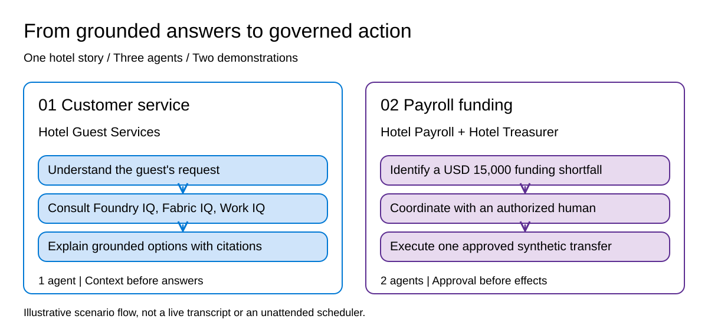
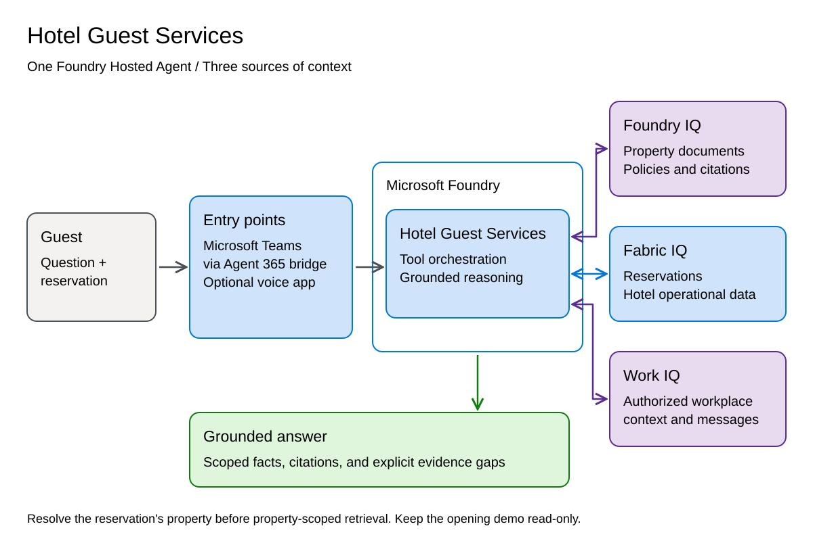
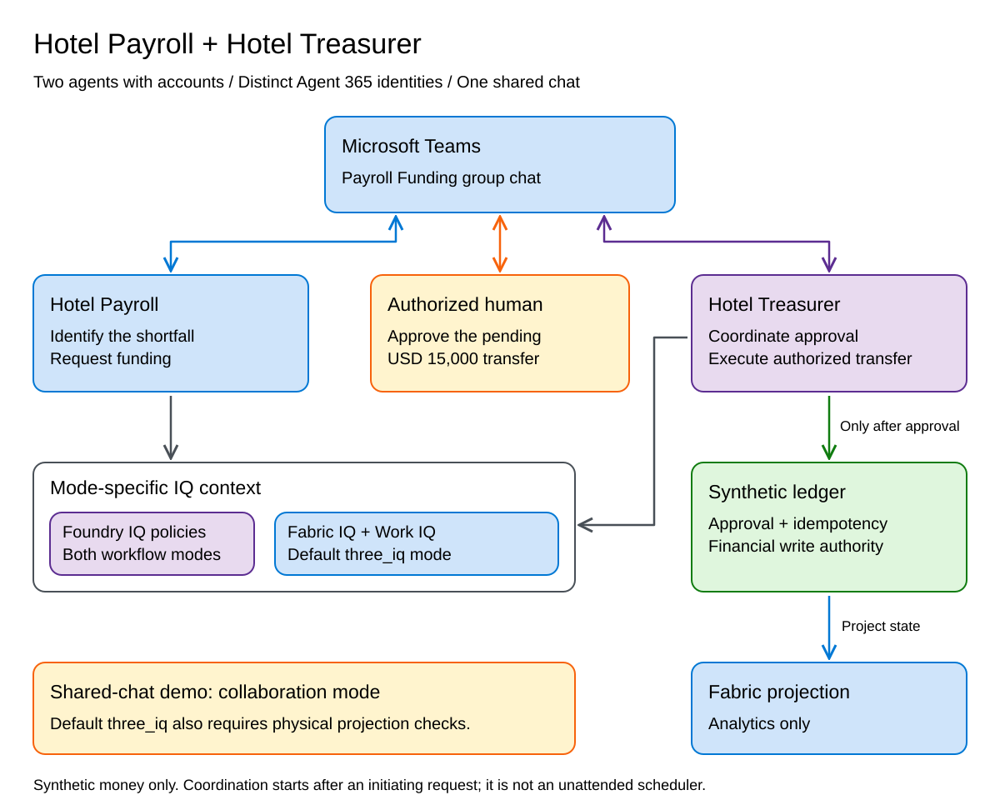

# Ignite 2026 BRK301: From grounded answers to agents that act

One hotel story, three agents, two demonstrations: start with the Hotel Guest
Services customer-service agent using Microsoft IQ, then bring Hotel Payroll
and Hotel Treasurer into the same Microsoft Teams group chat. These two agents
with accounts coordinate payroll funding with human approval through Agent 365.

Opens guided setup in your own GitHub Codespace. Azure, Fabric, Microsoft 365,
and Agent 365 configuration still require your account and administrator steps.
[Deployment guide](docs/deploy.md) |
[Launch-click tracking](docs/deploy-tracker.md)

[Editable scenario overview](docs/images/scenario-overview.excalidraw)

| Agent | Role | Demo |
| --- | --- | --- |
| Hotel Guest Services | Answers customer-service questions using Foundry IQ policy and property knowledge, Fabric IQ operational data, and Work IQ workplace context. | [Customer-service agent](demos/customer-service-agent/README.md) |
| Hotel Payroll | Identifies the payroll funding shortfall and requests funding in the shared chat. | [Payroll funding](demos/hotel-payroll-treasurer-agents/README.md) |
| Hotel Treasurer | Coordinates human approval, executes the authorized synthetic transfer, and reports the result. | [Payroll funding](demos/hotel-payroll-treasurer-agents/README.md) |

`hotel-payroll-treasurer-agents` is the shared demo folder for Hotel Payroll and
Hotel Treasurer; `hotel_payroll_treasurer_agents` is its Python package name,
not another agent.

Start with the [session walkthrough](docs/demo-walkthrough.md), then read the
[architecture](docs/architecture.md) and [setup guide](docs/setup.md).
The projects have independent environments and deployment entry points; do not
install both Python dependency sets in one environment.

## Scenario 1: Customer-service agent

Hotel Guest Services combines reservation data, property policies, and
authorized workplace context to explain a guest's options.

Resolve the reservation's actual property before property- and date-scoped
policy retrieval. Keep the opening demo read-only; optional actions require
their own confirmation and configured backend.
[Editable architecture](docs/images/customer-service-architecture.excalidraw)

## Scenario 2: Hotel Payroll and Hotel Treasurer

After an initiating request, the two agents coordinate in the **Payroll
Funding** Microsoft Teams chat. Hotel Treasurer must obtain authenticated
human approval before the synthetic USD 15,000 transfer.

The seed has payroll USD 10,000, reserve USD 50,000, and a USD 25,000 obligation.
One approved transfer leaves payroll USD 25,000 and reserve USD 35,000.
The ledger is authoritative; Fabric is analytical only. The shared-chat demo
uses explicit `collaboration` mode, not the default `three_iq` evidence path
or an unattended scheduler.
[Editable architecture](docs/images/payroll-treasurer-architecture.excalidraw)

## What is included

- Foundry Hosted Agent implementations, prompts, tools, infrastructure templates,
  synthetic hotel datasets, knowledge documents, and tests.
- An optional authenticated voice frontend for customer service.
- Two independent agents with accounts, each with its own Agent 365 identity,
  and a durable, idempotent simulated finance ledger with approval and
  duplicate-delivery handling.
- Offline checks and GitHub Actions validation that do not deploy resources,
  send messages, hire agents, or move money.

This is a conference sample, not a production banking integration or a
one-command tenant deployment. Cloud execution requires your own Azure,
Microsoft Fabric, Microsoft 365, and Agent 365 access, permissions, capacity,
and compatible preview features. The sample contains no live tenant bindings.
Values beginning with `replace`, `REPLACE_WITH_`, and sample UUIDs beginning
`00000000-0000-4000-8000-` must be replaced with your own deployment outputs.

## Validation

See each project's README for isolated local checks. The
[validation workflow](.github/workflows/validate.yml) runs customer-service
Python checks, the voice frontend checks, the Agent 365 bridge tests, payroll
tests, and the repository publication checks.
The deployment entry-point job also tests the click tracker and compiles its
infrastructure; it does not deploy agents.

Source lineage and intentional exclusions are recorded in
[source attribution](docs/source-attribution.md). These scenario and architecture
illustrations are original, with editable Excalidraw sources. Slide-derived
visuals are not included; the session deck remains a separate presentation.
No live chat transcripts, tenant screenshots, or operator acceptance evidence
are distributed with the sample.

## Contributing

This project welcomes contributions and suggestions.  Most contributions require you to agree to a
Contributor License Agreement (CLA) declaring that you have the right to, and actually do, grant us
the rights to use your contribution. For details, visit [Contributor License Agreements](https://cla.opensource.microsoft.com).

When you submit a pull request, a CLA bot will automatically determine whether you need to provide
a CLA and decorate the PR appropriately (e.g., status check, comment). Simply follow the instructions
provided by the bot. You will only need to do this once across all repos using our CLA.

This project has adopted the [Microsoft Open Source Code of Conduct](https://opensource.microsoft.com/codeofconduct/).
For more information see the [Code of Conduct FAQ](https://opensource.microsoft.com/codeofconduct/faq/) or
contact [opencode@microsoft.com](mailto:opencode@microsoft.com) with any additional questions or comments.

## Trademarks

This project may contain trademarks or logos for projects, products, or services. Authorized use of Microsoft
trademarks or logos is subject to and must follow
[Microsoft's Trademark & Brand Guidelines](https://www.microsoft.com/legal/intellectualproperty/trademarks/usage/general).
Use of Microsoft trademarks or logos in modified versions of this project must not cause confusion or imply Microsoft sponsorship.
Any use of third-party trademarks or logos are subject to those third-party's policies.
