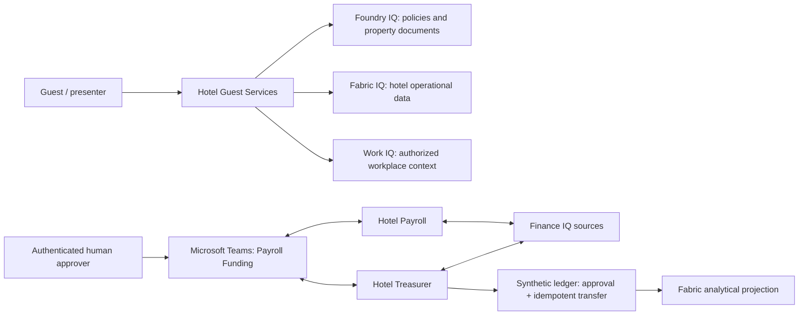

# Demo architecture

The repository unifies the session narrative, not the deployed identities or
financial state stores.

## Customer service

`demos/customer-service/src/hotel-servicing-agent` contains the Foundry Hosted
Agent. Its tools separate unstructured policy retrieval, structured Fabric data,
guarded mutations, and Work IQ. Property identity must be established from actual
reservation data before property-scoped policy retrieval. Dates and citations
remain part of the evidence boundary.

The `agent` directory contains the Agent 365 messaging bridge. `web` contains an
optional signed-in voice frontend and backend proxy. They are separate runtime
surfaces, not extra payroll agents.

## Payroll collaboration

`demos/payroll-autopilots/src/finance_autopilots` contains two independently
hired agents with accounts, governed by Agent 365. Stable internal role keys are
`hotel_finance` and `banking_operations`; user-facing names are Hotel Payroll
and Hotel Treasurer.
Do not rename role keys or reuse one identity for both agents.

The customer-facing term is **agents with accounts**. Existing source paths,
package names, resource names, and API fields that contain `autopilot` are
compatibility identifiers, not the current product terminology.

The transactional ledger is authoritative. Amounts are integer cents; approval,
balance updates, transaction identity, and notification state are durably guarded
against concurrent or repeated execution. Amounts above USD 10,000 require an
authenticated configured approver. Fabric is a projection for analysis, never
the financial write authority.

In the default `three_iq` mode, successful evidence consultations and physical
projection validation gate model-driven effect tools. `collaboration` is an
explicit alternate workflow for the shared-chat demo. These modes must not be
presented as interchangeable evidence guarantees.

## Deployment boundaries

Each project keeps its original relative directory layout so Docker contexts,
tests, and scripts continue to resolve their own assets. No root `azd up` command
deploys the combined repository. Local validation does not alter a live tenant.
The source import is not evidence that a replacement-tenant deployment works.
